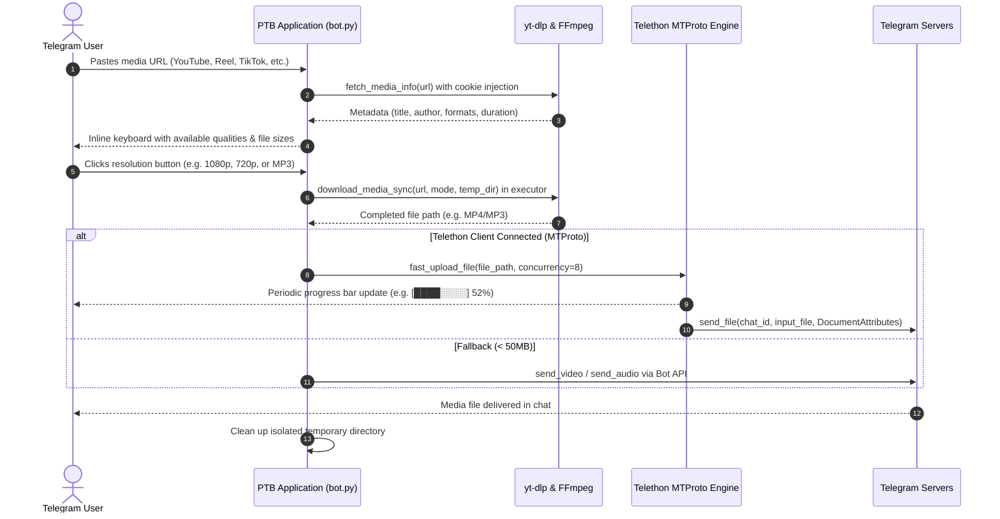

# Architecture — Universal 2GB Downloader Bot

> Auto-generated by /map on 2026-11-08

## Overview

The **Universal 2GB Downloader** is a high-throughput Telegram bot engineered to run in low-resource environments (specifically Android Termux or Linux VPS) while enabling downloads up to **2,000 MB (2 GB)** across major social and streaming platforms (YouTube, Instagram, TikTok, X/Twitter, Reddit, Pinterest, SoundCloud, and Facebook).

```
┌─────────────────────────────────────────────────────────────┐
│                      Telegram User Chat                     │
└──────────────────────────────┬──────────────────────────────┘
                               │  URL / Button Callbacks / Cookies
                               ▼
┌─────────────────────────────────────────────────────────────┐
│             Bot Controller Layer (bot.py)                   │
│   • python-telegram-bot Application (HTTPX async polling)   │
│   • URL detection & platform categorization                 │
│   • In-chat Netscape cookie validator & manager             │
│   • Button callback dispatcher & media cache                │
└──────────────┬──────────────────────────────┬───────────────┘
               │                              │
               ▼                              ▼
┌──────────────────────────────┐ ┌────────────────────────────┐
│   Media Extraction Layer     │ │    Delivery / Upload Layer │
│   • yt-dlp extractor engine  │ │   • Primary: Telethon      │
│   • Multi-stream fragment dl │ │     MTProto 2GB parallel   │
│   • Mobile client fallback   │ │     uploader (512KB chunks)│
│     (Android/iOS rotation)   │ │   • Secondary: Standard    │
│   • Cookie loader (Netscape) │ │     Bot API (<= 50MB)      │
│   • Native FFmpeg audio mux  │ │   • Real-time progress bar │
└──────────────────────────────┘ └────────────────────────────┘
```

---

## Components

### 1. Telegram Polling & UI Engine (`bot.py:main`, `bot.py:start_command`, `bot.py:handle_message`)
- **Purpose:** Handles async long-polling, command routing (`/start`, `/help`, `/cookies`), URL regex extraction, interactive inline button rendering, and network drop recovery.
- **Location:** [bot.py](file:///c:/Users/sanif/OneDrive/Desktop/telegram-media-downloader/bot.py#L424-L660)
- **Dependencies:** `telegram`, `telegram.ext`, `telegram.request.HTTPXRequest`

### 2. Media Extraction & Resolution Parsing (`bot.py:fetch_media_info`, `bot.py:extract_available_formats`)
- **Purpose:** Fast metadata extraction without downloading. Parses video streams, estimates file sizes for vertical (9:16 Shorts/Reels) and landscape formats, and formats user choice keyboards.
- **Location:** [bot.py](file:///c:/Users/sanif/OneDrive/Desktop/telegram-media-downloader/bot.py#L247-L359)
- **Dependencies:** `yt-dlp`

### 3. Anti-Bot & Cookie Session Manager (`bot.py:resolve_cookies`, `bot.py:handle_document`, `bot.py:cookies_command`)
- **Purpose:** Prevents YouTube bot verification challenges ("Sign in to confirm you're not a bot") and Instagram private reel blocks. Accepts live `.txt` cookie uploads directly in Telegram chat, validates Netscape schema, and hot-swaps active sessions without process restart.
- **Location:** [bot.py](file:///c:/Users/sanif/OneDrive/Desktop/telegram-media-downloader/bot.py#L85-L146), [bot.py](file:///c:/Users/sanif/OneDrive/Desktop/telegram-media-downloader/bot.py#L461-L553)
- **Dependencies:** Standard library, `cookies/` storage

### 4. Media Download Worker (`bot.py:download_media_sync`)
- **Purpose:** Thread-offloaded download pipeline. Concurrently downloads fragments (8 streams), muxes video/audio streams via FFmpeg, extracts MP3 audio if requested, and yields verified media file paths.
- **Location:** [bot.py](file:///c:/Users/sanif/OneDrive/Desktop/telegram-media-downloader/bot.py#L361-L422)
- **Dependencies:** `yt-dlp`, FFmpeg (`bin/ffmpeg` or Termux `/usr/bin/ffmpeg`)

### 5. High-Speed 2GB MTProto Parallel Uploader (`fast_telethon.py`, `bot.py:handle_callback`)
- **Purpose:** Direct MTProto client bypassing Telegram Bot API 50MB HTTP limit. Splits files into 512KB chunks uploaded concurrently across 8 pipes, streaming live progress percentages to the user.
- **Location:** [fast_telethon.py](file:///c:/Users/sanif/OneDrive/Desktop/telegram-media-downloader/fast_telethon.py#L1-L60), [bot.py](file:///c:/Users/sanif/OneDrive/Desktop/telegram-media-downloader/bot.py#L735-L824)
- **Dependencies:** `telethon`, `telethon.tl.types`

---

## Data Flow



---

## External Integrations

| Service / Tool | Type | Purpose | Configuration |
|---|---|---|---|
| **Telegram Bot API** | HTTPS Long-Polling | User interaction, commands, keyboards | `TELEGRAM_BOT_TOKEN` |
| **Telegram MTProto** | TCP Binary Protocol | 2,000 MB parallel upload engine | `TELEGRAM_API_ID`, `TELEGRAM_API_HASH` |
| **YouTube** | Extractor API | Video, Shorts, Music streaming extraction | `cookies/youtube_cookies.txt`, mobile clients |
| **Instagram** | Extractor API | Reels, Posts, Stories extraction | `cookies/instagram_cookies.txt` |
| **FFmpeg** | Local Binary | Audio extraction (MP3) and video/audio muxing | Auto-detected: Termux, System PATH, or `bin/` |

---

## Technical Debt & Opportunities

- [ ] **Volatile Media Cache:** `MEDIA_CACHE` is an in-memory dictionary. A bot restart invalidates pending format selection buttons.
- [ ] **Concurrency & Queue Management:** Concurrent large downloads (multiple users) run unbounded in thread executor, risking disk exhaustion on mobile devices.
- [ ] **Progress Updates on Slow Connections:** `edit_message_text` progress updates can occasionally trigger Telegram rate limits (`RetryAfter`) during 100MB+ transfers.
- [ ] **Playlist Batch Downloading:** Playlists are currently forced to `no_playlist: True`. Batch/archive downloading is not yet implemented.
- [ ] **Cookie Expiration Notification:** When a cookie session expires, the bot only catches the error when a download fails rather than proactively alerting the owner.

